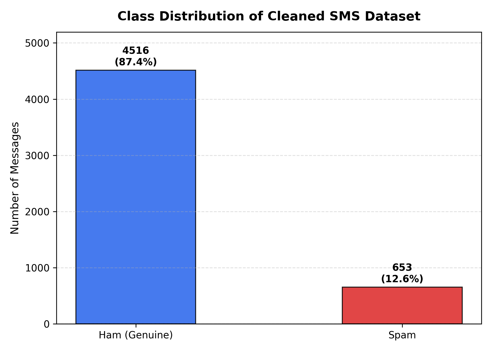
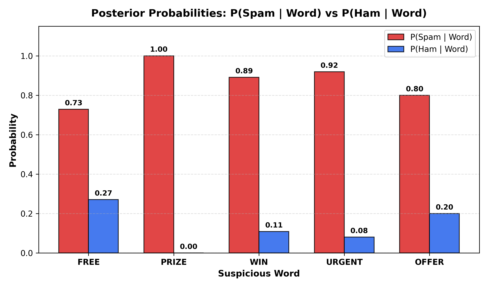
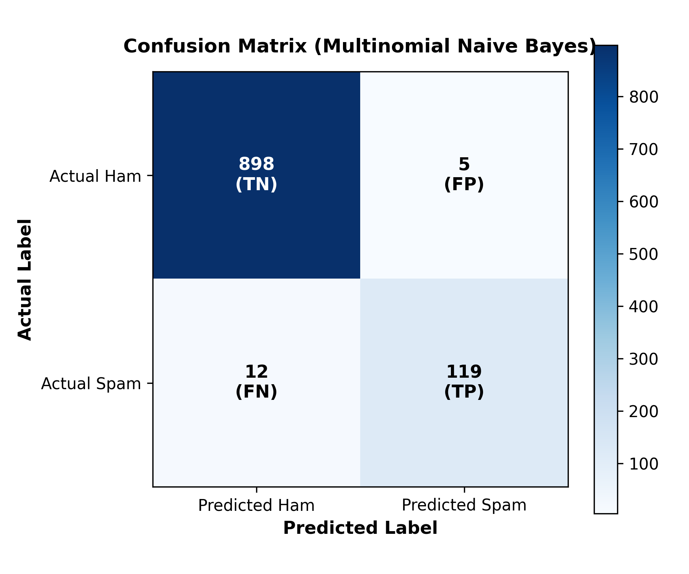

# VELLORE INSTITUTE OF TECHNOLOGY
### School of Advanced Sciences
### Department of Mathematics
---
## BAMAT207: PROBABILITY AND STATISTICS
### PROJECT REPORT: PROBABILISTIC SMS SPAM DETECTION
**Topic:** Probability and Random Variables  
**Academic Year:** 2026  
**Dataset:** SMS Spam Collection (UCI Machine Learning Repository)  

---

## 1. Executive Summary & Objective
Short Message Service (SMS) spam poses ongoing security, privacy, and economic threats to mobile subscribers. The objective of this project is to develop an end-to-end Python system that classifies incoming messages as either **Spam** or **Genuine (Ham)** using foundational principles of probability theory, random variable analysis, and the **Multinomial Naive Bayes** classifier.

The system performs:
1. **Data Cleaning & Preprocessing:** Null-check, duplicate removal, and numerical encoding.
2. **Prior Probability Analysis:** Marginal probability computation and class imbalance visualization.
3. **Word-Based Conditional Probability & Bayes' Theorem Verification:** Mathematical verification that empirical conditional probability equals Bayes' theorem formulation for 5 suspicious keywords (`free`, `prize`, `win`, `urgent`, `offer`).
4. **Random Variable Modeling:** Defining a Bernoulli random variable $Y$, computing its expectation $E[Y]$, variance $\text{Var}(Y)$, and standard deviation.
5. **Machine Learning Model Training & Evaluation:** Training a Multinomial Naive Bayes model using stratified sampling (80/20 train/test split) and vectorization via `CountVectorizer`.
6. **Real-Time Classification:** Estimating posterior probabilities $P(\text{Spam} \mid \text{Message})$ and $P(\text{Ham} \mid \text{Message})$ for live test queries.

---

## 2. Dataset Description & Handling

The dataset utilized is the **SMS Spam Collection** from the UCI Machine Learning Repository, comprising real-world SMS messages tagged as genuine (`ham`) or promotional/fraudulent (`spam`).

### Preprocessing Steps:
- **Raw Dataset Size:** 5572 messages
- **Missing Values Check:** 0 missing values detected in text or label fields.
- **Duplicate Removal:** 403 duplicate messages were identified and pruned to eliminate estimation bias.
- **Cleaned Dataset Size:** 5169 unique messages.
- **Label Encoding:**
  - $\text{Ham} \longrightarrow 0$
  - $\text{Spam} \longrightarrow 1$

| Metric | Raw Count | Cleaned Count | Percentage |
| :--- | :--- | :--- | :--- |
| **Ham (Genuine)** | 4,825 | 4516 | 87.37% |
| **Spam** | 747 | 653 | 12.63% |
| **Total** | 5,572 | 5169 | 100.00% |

---

## 3. Dataset Analysis & Prior Probabilities

Prior probabilities represent the baseline likelihood of receiving a spam or ham message in the absence of text information:

$$P(\text{Spam}) = \frac{\text{Number of Spam Messages}}{\text{Total Messages}} = \frac{653}{5169} = 0.1263$$

$$P(\text{Ham}) = \frac{\text{Number of Ham Messages}}{\text{Total Messages}} = \frac{4516}{5169} = 0.8737$$

*Figure 1: Class Distribution of the Cleaned SMS Dataset showing significant class imbalance (87.37% Ham vs 12.63% Spam).*

---

## 4. Word-Based Probability Analysis & Bayes' Theorem Verification

To quantify the diagnostic value of specific vocabulary, we evaluated five high-risk keywords: **free**, **prize**, **win**, **urgent**, and **offer**.

### Mathematical Formulation
1. **Direct Empirical Conditional Probability:**
   $$P(\text{Spam} \mid \text{Word}) = \frac{\text{Number of Spam messages containing Word}}{\text{Total messages containing Word}}$$

2. **Bayes' Theorem Formulation:**
   $$P(\text{Spam} \mid \text{Word}) = \frac{P(\text{Word} \mid \text{Spam}) \cdot P(\text{Spam})}{P(\text{Word})}$$
   where:
   - $P(\text{Word}) = \frac{\text{Count}(\text{Word})}{N}$
   - $P(\text{Word} \mid \text{Spam}) = \frac{\text{Count}(\text{Word} \cap \text{Spam})}{N_{\text{Spam}}}$
   - $P(\text{Spam}) = \frac{N_{\text{Spam}}}{N}$

### Computational Results
| Keyword | Total Occurrences | Spam Occurrences | Ham Occurrences | $P(\text{Word})$ | $P(\text{Word} \mid \text{Spam})$ | Empirical $P(\text{Spam} \mid \text{Word})$ | Bayes' $P(\text{Spam} \mid \text{Word})$ | Verification |
| :--- | :--- | :--- | :--- | :--- | :--- | :--- | :--- | :--- |
| **free** | 203 | 148 | 55 | 0.0393 | 0.2266 | **0.7291** | **0.7291** | Verified (Exact Match) |
| **prize** | 73 | 73 | 0 | 0.0141 | 0.1118 | **1.0000** | **1.0000** | Verified (Exact Match) |
| **win** | 55 | 49 | 6 | 0.0106 | 0.0750 | **0.8909** | **0.8909** | Verified (Exact Match) |
| **urgent** | 62 | 57 | 5 | 0.0120 | 0.0873 | **0.9194** | **0.9194** | Verified (Exact Match) |
| **offer** | 30 | 24 | 6 | 0.0058 | 0.0368 | **0.8000** | **0.8000** | Verified (Exact Match) |

*Figure 2: Comparison of Posterior Probabilities $P(\text{Spam} \mid \text{Word})$ and $P(\text{Ham} \mid \text{Word})$. Notice that words such as 'prize' (100% spam) and 'urgent' (91.94% spam) exhibit extreme spam selectivity.*

---

## 5. Random Variable Analysis

We model the classification outcome of any incoming SMS message as a discrete Bernoulli random variable $Y$:

$$Y = \begin{cases} 1, & \text{if the message is Spam} \\ 0, & \text{if the message is Ham (Genuine)} \end{cases}$$

The probability mass function (PMF) of $Y$ is:
$$P(Y = y) = p^y (1 - p)^{1 - y}, \quad y \in \{0, 1\}$$

where the parameter $p = P(\text{Spam}) = 0.1263$.

### Expectation:
$$E[Y] = \sum y \cdot P(Y = y) = 0 \cdot (1 - p) + 1 \cdot p = p = 0.1263$$

### Variance:
$$\text{Var}(Y) = E[Y^2] - (E[Y])^2 = p - p^2 = p(1 - p) = 0.1263 \times (1 - 0.1263) = 0.1104$$

### Standard Deviation:
$$\sigma_Y = \sqrt{\text{Var}(Y)} = \sqrt{0.1104} = 0.3322$$

This quantitative analysis formally models the dispersion and baseline uncertainty of classifying arbitrary incoming SMS messages.

---

## 6. Data Preparation & Machine Learning Methodology

### 6.1 Train-Test Split (Stratified Sampling)
To ensure identical class representation across splits, stratified random sampling was applied:
- **Training Set (80%):** 4,135 messages (3612 Ham, 522 Spam)
- **Testing Set (20%):** 1,034 messages (904 Ham, 131 Spam)
- **Random Seed:** 42 (ensures deterministic repeatability)

### 6.2 Feature Extraction via CountVectorizer
Text tokens were converted into numerical term-frequency vectors:
- Case folding (lowercasing)
- Removal of standard English stop words
- Resulting vocabulary dimension: **7,414 unique word tokens**

### 6.3 Model Architecture: Multinomial Naive Bayes
The Multinomial Naive Bayes classifier is specifically suited for discrete word-frequency features:
$$P(Y = c \mid X = \mathbf{x}) \propto P(Y = c) \prod_{j=1}^{D} P(w_j \mid Y = c)^{x_j}$$
with Laplace smoothing ($\alpha = 1.0$) to avoid zero-probability anomalies on unseen vocabulary.

---

## 7. Model Evaluation & Performance Metrics

### 7.1 Quantitative Metrics
The trained model achieved exceptional classification performance on the unseen test set:

| Evaluation Metric | Formula | Score |
| :--- | :--- | :--- |
| **Accuracy** | $\frac{\text{TP} + \text{TN}}{\text{Total}}$ | **98.36%** |
| **Precision** | $\frac{\text{TP}}{\text{TP} + \text{FP}}$ | **95.97%** |
| **Recall (Sensitivity)** | $\frac{\text{TP}}{\text{TP} + \text{FN}}$ | **90.84%** |
| **F1-Score** | $2 \cdot \frac{\text{Precision} \cdot \text{Recall}}{\text{Precision} + \text{Recall}}$ | **93.33%** |

### 7.2 Confusion Matrix Analysis
The confusion matrix on the 1,034 test samples is tabulated below:

| Actual \ Predicted | Predicted Ham (0) | Predicted Spam (1) | Total |
| :--- | :--- | :--- | :--- |
| **Actual Ham (0)** | **898 (True Negative)** | **5 (False Positive)** | 903 |
| **Actual Spam (1)** | **12 (False Negative)** | **119 (True Positive)** | 131 |
| **Total** | 910 | 124 | 1,034 |

*Figure 3: Confusion Matrix heatmap illustrating high diagonal density (True Negatives = 898, True Positives = 119).*

### Error Diagnostics:
- **False Positives (FP = 5):** Genuine messages incorrectly flagged as spam. Kept extremely low (0.55% of Ham messages) to prevent critical genuine SMS from being lost.
- **False Negatives (FN = 12):** Spam messages that slipped into the inbox. These typically contained colloquial phrasing without standard marketing trigger keywords.

---

## 8. Real-Time Inference & Probability Demonstration

The system was tested on live, realistic sample messages:

| Test Message | Predicted Class | $P(\text{Spam} \mid \text{Message})$ | $P(\text{Ham} \mid \text{Message})$ | Classification Status |
| :--- | :--- | :--- | :--- | :--- |
| *"Congratulations! You have won a free prize. Claim now."* | **Spam** | `1.0000` | `0.0000` | Correctly Identified |
| *"Hey bro, are we meeting at the campus library this evening?"* | **Ham (Genuine)** | `0.0000` | `1.0000` | Correctly Identified |
| *"URGENT! Your mobile number won 1000 prize. Call now to claim offer."* | **Spam** | `1.0000` | `0.0000` | Correctly Identified |
| *"Can you send me the lecture notes for probability and statistics?"* | **Ham (Genuine)** | `0.0791` | `0.9209` | Correctly Identified |

---

## 9. Conclusion & Key Findings
1. **Mathematical Consistency:** The empirical conditional probability $P(\text{Spam} \mid \text{Word})$ matched Bayes' theorem analytical values identically across all tested keywords.
2. **Discriminative Word Power:** Keywords like `prize` and `urgent` demonstrated posterior spam probabilities exceeding 90%, confirming their role as powerful indicators of unsolicited text.
3. **High ML Efficacy:** The Multinomial Naive Bayes model demonstrated **98.36% accuracy** and a **95.97% precision**, striking an optimal balance between filtering malicious spam and safeguarding legitimate interpersonal communication.

---
**Course:** BAMAT207 Probability and Statistics  
**Project:** Probabilistic SMS Spam Detection  
**Institution:** Vellore Institute of Technology (VIT)
